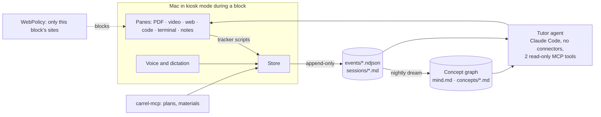

# Carrel

**A macOS study app that locks the Mac into focused blocks, records everything you do in them, and has an AI tutor that already knows it.**

Native Swift/SwiftUI · ~26,700 lines · 191 tests · 90 commits over two weeks (9–24 Nov 2026) · in daily use

## The problem

Studying alone on a laptop fails in two ways. One tab of distraction ends the session. And when you ask an AI for help, it knows nothing about what you just read, tried or got wrong, so you have to explain it all again every time.

## What it does

| | |
|---|---|
| **Plan** | A plan is a set of days, each made of timed blocks. Each block owns its material: PDFs, videos, web pages, a code folder. An AI can build multi-day plans through Carrel's MCP server, sized from how long the material actually is. |
| **Lock** | While a block runs, the Mac is in kiosk mode: the Dock, the menu bar, ⌘Tab and Force Quit are disabled, and shield windows cover other apps. A per-block web policy allows only that block's sites, and any link that leaves them is blocked. Safe Mode is the only way out. |
| **Record** | Each pane (reader, video, code editor, terminal, notes, chat) reports what you do: reading time, selections, questions, voice clips, code runs, recall answers. Each becomes a `StudyEvent` appended to `events/<day>.ndjson`. |
| **Remember** | Every night a "dream" pass reads the day's log and updates a concept graph. Each concept gets a mastery estimate, dated evidence, misconceptions and links to what must be learned first. It shows up as a mind map and as small Markdown files the tutor reads. |
| **Tutor** | An in-app Claude agent answers from that record: what's open on screen, the current block, and the concepts you're weak on. You don't have to repeat yourself. |

## How it fits together

## Rule 1: nothing the learner does disappears

This is the project's main rule, and it is enforced in code review and tests. A feature that takes input and doesn't log it counts as broken, however good it looks. It was learned the hard way: an early "Ask Google AI" button worked perfectly, but none of the questions were recorded, so the tutor never saw them.

For every new kind of input there are four checks. Is it recorded? Is the useful text kept, not just "user asked something"? Is it kept outside a block? Does it reach the nightly dream? A test (`testEveryAskReachesTheDream`) fails if any `ask` type is missing from the dream.

## Why it's relevant to AccuKnox

Carrel has the same shape as runtime security for AI workloads, at the scale of one person:

| Carrel | Runtime security (KubeArmor, AI SOC) |
|---|---|
| Tracker scripts in every pane | Sensors (eBPF/LSM) in every container |
| Append-only event log | Telemetry / audit stream |
| Kiosk mode and the web policy | Enforcement: allowed processes, network, files |
| Nightly dream to concept graph | Correlation into a security graph |
| A tutor agent with 2 read-only tools | A triage agent with least privilege |
| Measured first-word latency and context size | Agent cost and latency budgets |

## Measured, not guessed

Every chat turn is logged to `perf/<day>.ndjson`: time to first word, cold or warm start, input, cache-write and cache-read tokens, and cost.

| Change | Before | After |
|---|---|---|
| Warm process, hooks off, one MCP server with few tools | about 3.7 s to first word, 40–45k tokens per new chat | 1.3–1.6 s, 26k tokens |
| Voice walkthrough ("walk me through this slide") | 22.7 s to first word | 7.0–8.3 s, and cost per question 0.46¢ → 0.29¢ |
| Mind map, 400 concepts | | settles in 139 ms (about 0.5 ms per physics tick) |

## Stack

Swift and SwiftUI with AppKit (kiosk options, shield windows), WKWebView panes with injected tracker scripts, a Monaco code editor, a real terminal, Claude Code as the agent runtime, and a Swift MCP server (`carrel-mcp`). State is plain files on disk: NDJSON for events and Markdown for everything people and agents read.
