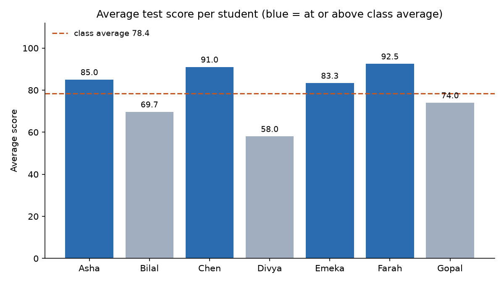

# AccuKnox – Assignment Responses


Where the questions left something open, I picked an assumption and wrote it down next to the answer.

---

## Problem Statement 1

All code is in [`problem1/`](./problem1). It needs Python 3.10+ with `requests` and `matplotlib`. Storage uses the standard-library `sqlite3`. A small local mock API (`mock_api.py`) means the scripts and the 7 unit tests run offline. Every assumption is listed in [`problem1/README.md`](./problem1/README.md).

```bash
pip install requests matplotlib && cd problem1
python mock_api.py &                      # serves /books and /students on :8765
python q1_books.py                        # Q1 (live Open Library API)
python q2_scores.py                       # Q2 -> scores.png
python q3_csv_import.py data/users.csv    # Q3
python -m unittest test_problem1 -v       # 7 tests, all passing
```

### Q1 · API → SQLite → display (`q1_books.py`)

| Step | Design choice | Why |
|---|---|---|
| Fetch | Default source is the public **Open Library** search API. `--url` accepts any API returning `[{title, author, publication_year}]`. | The question names no API. Open Library is real, free and needs no key. |
| Resilience | 10 s timeout. Network errors and 5xx are retried 3× with exponential backoff. A 4xx fails at once. | A 5xx or a timeout may go away on retry. A 404 won't. |
| Clean | Records without a title or author are dropped and counted. A non-numeric or missing year becomes `NULL`. | Bad upstream data shouldn't crash the import or turn into a fake year 0. |
| Store | `UNIQUE(title, author)` + `INSERT … ON CONFLICT DO UPDATE`, one transaction. | Re-running the script is **idempotent**: it adds no duplicates and refreshes the data. |
| Display | Aligned table, sorted by year, unknown years last. | |

```
$ python q1_books.py
fetched 15 records: 14 new, 1 already stored or repeated, 0 dropped as incomplete

Title                                               Author                 Year
--------------------------------------------------  ---------------------  ----
Distributed systems                                 George F. Coulouris    1996
Distributed Systems                                 Andrew S. Tanenbaum    2001
Security Engineering                                Ross J. Anderson       2001
Designing Distributed Systems                       Brendan Burns          2018
Understanding Distributed Systems, Second Edition   Roberto Vitillo        2022
...
```

### Q2 · Fetch scores → average → bar chart (`q2_scores.py`)

**Assumption:** no public student-scores API exists, so the data comes from the local mock with the shape `[{id, name, scores: {subject: score | null}}]`. A `null` score means the student was **absent**. It is left out of the average rather than counted as 0. One student (Farah) is set up to test this: she averages 92.5, not 61.7.

"Average score" can mean three things, so the script reports all three:

| Metric | Value |
|---|---|
| Class average (over all 20 individual scores) | **78.40** |
| Per subject | math 78.4 · physics 79.0 · chemistry 77.7 |
| Per student | the bars below |



### Q3 · CSV → SQLite (`q3_csv_import.py`)

```sql
CREATE TABLE users (
  id         INTEGER PRIMARY KEY AUTOINCREMENT,
  name       TEXT NOT NULL CHECK (length(trim(name)) > 0),
  email      TEXT NOT NULL UNIQUE COLLATE NOCASE,
  created_at TEXT NOT NULL DEFAULT (datetime('now'))
);
```

- The header is checked, and columns are matched case-insensitively. Extra columns are ignored, and an Excel BOM is handled.
- Each row is validated. A rejected row is **reported with its line number** and the rest of the file still imports.
- Email is the identity. A repeat (including a different case, `ASHA.RAO@` vs `asha.rao@`) is skipped and reported, never silently overwritten.
- The whole file goes in **one transaction**, so a crash halfway leaves the table unchanged.

```
$ python q3_csv_import.py data/users.csv
inserted 5, skipped 1 duplicate(s), rejected 2 invalid row(s)
  line 5: empty name
  line 6: invalid email 'not-an-email'
  line 8: duplicate email asha.rao@example.com
users table now has 5 rows
```

### Q4 · Most complex Python code

**[`q4_tinyvec/`: tinyvec, a vector database from scratch](./q4_tinyvec)** (~630 lines of library + benchmark + 11 tests)

| Component | What's hard about it |
|---|---|
| HNSW graph index | Layered small-world graph, beam search with `ef`, the paper's neighbour-diversity heuristic, bounded degree, numpy-batched distances |
| Filtered search + **cost-based query planner** | Chooses between an exact scan of payload-index matches and filtered graph traversal by estimating both costs. The cost per hop is learned from past queries. |
| Durability | CRC'd write-ahead log, fsynced before the call returns (`F_FULLFSYNC` on macOS), atomic snapshots via a `CURRENT` pointer, torn-tail repair on recovery. Tested by **SIGKILLing a writer process 3 times**: zero acknowledged writes lost. |
| int8 scalar quantization | 4× less memory; score from codes, oversample, rescore |

Measured (N=8000, d=64):

| | recall@10 | cost (distance computations) |
|---|---|---|
| exact | 1.000 | 8000 |
| HNSW ef=64 | 0.963 | 1141 |
| HNSW ef=128 | 0.994 | 1940 |
| Filter = 1 % tenant, naive post-filter | **0.052** (117/200 queries empty) | 1141 |
| Filter = 1 % tenant, planner → exact | **1.000** | **86** |

Demo: semantic search over 3,000 Kubernetes security alerts across 6 tenants, then a simulated crash and recovery.

### Q5 · Most complex database code

**[`q5_forensics/`: runtime-security forensics store on SQLite](./q5_forensics)** (schema + ~10 named queries + 11 tests)

Takes in container process/file/network events, rebuilds **process trees** (handling PID reuse with a partial unique index), runs **detection policies as one SQL upsert statement**, and dedupes alerts with a partial unique index. It then investigates a simulated **web-shell → crypto-miner** attack:
- **Recursive CTEs** for process ancestry ("how did `/tmp/.k` start?" → `/pause → php-fpm → sh → sh → /tmp/.k`) and blast radius.
- A **kill-chain query**: shell spawned by an app server, then any descendant connects to a public IP within 60 s.
- **Window functions** for burst detection (`RANGE BETWEEN 29 PRECEDING`) and top-N alerts per tenant.
- An **expression index** on `json_extract(detail,'$.dst_ip')` for IOC pivots, and **FTS5** with BM25 for free-text hunting.
- **Triggers** make the evidence append-only, enforce the alert state machine, and write the audit trail themselves.
- **Concurrency:** 4 writer processes × 50 transactions on one alert → exactly 200 hits, no lost updates. Tests also assert on `EXPLAIN QUERY PLAN`.

---

## Assignment 2

### 1 · Self-rating

| Area | Rating | Basis |
|---|---|---|
| LLM (prompting, RAG, tool calling, evals, serving) | **B** | Can design and build RAG/chatbot systems and their retrieval layer (see Q4). Would want review on eval design and fine-tuning. |
| AI (applied systems: agents, search, ranking) | **B** | Built ANN search, filtering and planning from scratch; agents and ranking work under guidance |
| ML (classical: regression, trees, evaluation) | **B** | Comfortable with the workflow and metrics (recall, precision, train/test splits); needs supervision on model selection and tuning at production level |
| Deep Learning (architectures, training) | **C** | Understand embeddings and transformers conceptually; have not trained deep networks |

*A = can code independently · B = can code under supervision · C = little or no understanding*

### 2 · Key architectural components of an LLM-based chatbot

An LLM on its own is a stateless text-completion function. It has no memory, no access to your data, no permissions model, and it can be wrong with full confidence. A production chatbot is mostly the **system around the model** that makes up for those gaps. I split it into an online path, which answers a message, and an offline path, which prepares knowledge and measures quality.

```mermaid
flowchart LR
  U[User / UI<br/>web, Slack, API] -->|SSE / WebSocket| GW[API gateway<br/>auth · rate limit · tenant]
  GW --> ORC[Orchestrator<br/>conversation state machine]
  ORC <--> MEM[(Session memory<br/>history + summaries)]
  ORC --> GIN[Input guardrails<br/>PII · injection · policy]
  ORC --> RET[Retriever<br/>hybrid search + rerank]
  RET <--> VDB[(Vector DB +<br/>keyword index)]
  ORC --> PB[Prompt builder<br/>system + context + history<br/>within token budget]
  PB --> LLM[LLM gateway<br/>routing · fallback · cache · streaming]
  LLM <--> TOOLS[Tools / function calling<br/>APIs, DB queries, actions]
  LLM --> GOUT[Output guardrails<br/>grounding · citations · moderation]
  GOUT --> U
  ORC -.traces.-> OBS[Observability<br/>tokens · latency · cost]

  subgraph Offline
    SRC[Docs, tickets, KB] --> ING[Ingest<br/>parse · chunk · embed] --> VDB
    OBS --> EVAL[Eval sets + feedback<br/>regression tests on prompts]
  end
```



| # | Component | Responsibility | Key decisions |
|---|---|---|---|
| 1 | **Client + API gateway** | Streams tokens to the UI. Handles auth, per-tenant rate limits and quotas. | SSE vs WebSocket. Per-user token budgets, because LLM cost scales with use. |
| 2 | **Orchestrator** | The control loop: receive a message → decide whether to retrieve or call a tool → build the prompt → call the model → post-process. | Fixed pipeline (predictable, cheap) vs agent loop (flexible; needs a step limit and a cost limit). |
| 3 | **Memory** | The model is stateless, so the app re-sends context on every turn. | Sliding window + rolling summary for long chats. Long-term user facts kept in a store. |
| 4 | **Knowledge / RAG** | Grounds answers in private, fresh data without retraining. | Chunk size and overlap, embedding model, **hybrid** (BM25 + vector) search, a reranker, metadata filters such as tenant and access rights. |
| 5 | **Prompt builder** | Assembles system instructions, retrieved chunks, history and tool schemas within the context window. | Token budgeting and priority order. Kept as versioned templates. |
| 6 | **LLM gateway** | One interface to many models. | Routes cheap and simple queries to a small model and hard ones to a large model. Fallback on 429/5xx. Semantic cache. Streaming. |
| 7 | **Tools** | Lets the bot *act*: query a DB, open a ticket, call an API. | Strict JSON schemas. Least-privilege credentials. Human confirmation for destructive actions. |
| 8 | **Guardrails** | Input: prompt-injection detection, PII redaction, topic policy. Output: moderation, "answer only from sources", citations. | Treat retrieved documents as untrusted input too (indirect prompt injection). |
| 9 | **Observability + evals** | Traces of every step, token cost, latency, user feedback. An offline eval set (golden Q&A) runs on every prompt or model change. | Without evals, a prompt change is a guess. LLM-as-judge plus human spot checks. |

**Approach I'd follow to build one:**
1. Start with the **eval set** (50–100 real questions with expected answers or sources). It defines "good".
2. Ship the simplest pipeline first: retrieve → prompt → answer with citations. Measure retrieval recall separately from answer quality, because most "hallucinations" in RAG are really retrieval misses.
3. Add hybrid search and a reranker, then tools, then agentic loops, and only where the evals show a gap.
4. Fine-tuning comes last. It changes *style and format* well but is a poor way to add *knowledge*; RAG does that better and stays fresh.

**Latency budget** (typical target: first token in < 1.5 s):

| Step | Typical |
|---|---|
| Auth + guardrails | 20–80 ms |
| Embed query | 20–50 ms |
| Vector + keyword search | 10–50 ms |
| Rerank top-50 | 50–200 ms |
| LLM time-to-first-token | 300–1000 ms |
| **Total to first token** | **≈ 0.4 – 1.4 s**, then streamed |

### 3 · Vector databases

**What they are.** An embedding model maps text, images or code to a vector, say 768 floats, so that *similar meaning ⇒ nearby vectors*. A vector database stores these vectors and answers "give me the k vectors nearest to this query vector" quickly, usually filtered by metadata.

```
(illustrative numbers)
"pod escaped its container"  ──embed──▶ [0.12, -0.80, 0.33, …]  ─┐
"container breakout detected" ──embed──▶ [0.10, -0.78, 0.35, …]  ─┤  cosine ≈ 0.95 (close)
"quarterly revenue grew"     ──embed──▶ [-0.61, 0.22, -0.05, …] ─┘  cosine ≈ 0.08 (far)
```

**Why a special database?** An exact nearest-neighbour search compares the query against every vector, which is O(N·d). At 50 M vectors × 768 dims that is about 38 billion multiply-adds per query. Vector databases use **Approximate Nearest Neighbour (ANN)** indexes, which give up a little recall for orders of magnitude more speed:

| Index | Idea | Trade-off |
|---|---|---|
| **HNSW** | A multi-layer "small-world" graph. Search greedily hops toward the query. | Best recall/latency; memory-hungry (graph + vectors in RAM). The default in most databases. |
| **IVF** | k-means clusters the space. Search scans only the `nprobe` nearest clusters. | Less memory, faster to build; recall depends on `nprobe`. |
| **PQ / scalar / binary quantization** | Compresses vectors, e.g. float32 → int8 (4×) or → 1 bit (32×). | Large memory savings with some recall loss. Usually combined with re-scoring on full vectors. |
| **DiskANN-style** | Graph on SSD, compressed vectors in RAM. | Billion-scale on one machine; higher latency. |

**What a vector *database* adds over a library like FAISS:** inserts, updates and deletes while serving; persistence and replication; **metadata filtering** (`tenant = X AND severity >= high`) applied *during* the ANN search, not after it; hybrid keyword + vector search; access control; and backups.

**The landscape:**

| | Type | Strengths | Weaknesses |
|---|---|---|---|
| **pgvector** | Postgres extension | Vectors live next to your relational data with joins and transactions. No new system to run. | Single-node scale ceiling. Filtered ANN is weaker than in purpose-built engines. |
| **Qdrant** | Purpose-built, Rust, OSS | Filtering built into HNSW, quantization, payload-based multitenancy, self-hostable | One more system to operate |
| **Milvus** | Purpose-built, distributed, OSS | Billion-scale, many index types, GPU indexes | Heavy to operate (many dependent services) |
| **Pinecone** | Managed SaaS | No ops, serverless scaling | Data leaves your environment, vendor lock-in, cost at scale |
| **Weaviate** | Purpose-built, OSS | Built-in hybrid (BM25 + vector), modules for embedding | Memory-heavy at large scale |
| **Chroma / FAISS** | Embedded / library | Great for prototypes and notebooks | Not a multi-tenant production server (FAISS is not a DB at all) |

#### Hypothetical problem: a security copilot for runtime alerts

**Problem.** A cloud-native security platform produces runtime alerts across customers' Kubernetes clusters, for example "process `/bin/sh` spawned in pod `payments-7f9` violated policy `block-shell`". A SOC analyst asks in plain English: *"Have we seen anything like this container-escape alert before, and how was it resolved?"* The copilot must find **semantically similar past alerts, incident notes, policy docs and CVE advisories**, but **only from that customer's data**.

**Requirements and sizing (assumptions):**

| Requirement | Number / constraint |
|---|---|
| Corpus | 500 tenants · ~50 M chunks (alerts + notes + docs), growing ~1 M/day |
| Embeddings | 768-dim |
| Raw vector size | 50 M × 768 × 4 B ≈ **154 GB** float32 → ≈ **38 GB** with int8 scalar quantization |
| Query | p95 < 100 ms, top-k = 20, then rerank |
| Filters on **every** query | `tenant_id` (hard isolation), `cluster`, `severity`, `time range`, `source_type` |
| Deployment | Some customers require **self-hosted / air-gapped** installs |
| Writes | Continuous ingestion; old alerts expire after a retention window |

**Choice: Qdrant.**

| Requirement | How Qdrant fits |
|---|---|
| Strict tenant isolation on every query | Payload index on `tenant_id` marked as the tenant key. The filter is applied **inside** the HNSW traversal, so a small tenant isn't starved of results the way post-filtering top-k from a global index would be. |
| 38–154 GB of vectors | int8 scalar quantization keeps the compressed vectors in RAM and the originals on disk for re-scoring. Fits a 3-node cluster with replication. |
| Air-gapped customers | Open source (Apache-2.0), a single binary or Helm chart. Pinecone is out because it's SaaS. |
| Time-range + severity filters | Payload indexes on numeric, keyword and datetime fields. |
| Hybrid search for exact tokens (`CVE-2024-21626`, pod names) | Sparse vectors (BM25/SPLADE) beside dense vectors, fused at query time. |
| Retention | Delete by filter (`timestamp < now - 90d`). |

**Why not the others?**
- **pgvector** is my pick if the corpus were under ~5–10 M vectors, or if the alerts already lived in Postgres. One fewer system beats a slightly faster one. At 50 M with heavy tenant filtering it is the weaker fit.
- **Milvus** would win at billions of vectors, but its operational footprint is hard to ship into customer air-gapped clusters.
- **Pinecone** fails the self-hosting requirement.

**How I'd validate the choice before committing:** load a 5 M sample and run recall@20 against exact (brute-force) search, measuring p95 latency with filters for a *small* tenant (0.01 % of data) and a *large* one. Then sweep HNSW `m` / `ef` and the quantization settings. The filtered small-tenant case is where vector databases differ most, so it decides the choice.

**I checked this myself:** in [tinyvec](./q4_tinyvec) (Q4), naive post-filtering for a 1 % tenant gave recall 0.052, and for a 0.1 % tenant 0.011. Filtering inside the graph gave 1.000 but walked almost the whole graph. That trade-off is exactly why the filter-during-traversal design and a cost-based planner matter in this choice.

---

## Assignment 3

### Project I'm proud of

**[Carrel](./CARREL.md)**: a native macOS study app with an AI tutor that already knows what you did. It locks the Mac into timed study blocks with only that block's material reachable. It records every input as an event in an append-only log, and an in-app Claude agent with deliberately few permissions tutors from that record. It is about 26,700 lines of Swift with 191 tests, built in two weeks, and I use it every day.

### Why it's hard

1. **It's an AI agent living on my whole machine, so least privilege is the design, not an add-on.** The Mac is held in kiosk mode (no app switching, no Force Quit) and a per-block web policy blocks any navigation that leaves the material. The in-app agent runs with no account connectors, a strict MCP config and 2 read-only tools from Carrel's own server.
2. **"Nothing the learner does disappears" is a telemetry problem.** Every question, selection, voice clip and even text typed inside third-party web pages (captured by injected scripts) becomes an event in an append-only log. Tests guarantee that every kind of input reaches the nightly pass that turns the log into a concept graph. It is the same shape as runtime security: sensors, an event log, policy, then an agent reasoning over the evidence.
3. **An agent is only useful if it's fast, so every turn is measured.** By keeping a warm process and cutting hooks and extra MCP servers, the first word of a reply fell from about 3.7 s to 1.3–1.6 s and the context sent per new chat from about 45k to 26k tokens. A spoken "walk me through this" question went from 22.7 s to 7–8 s before the first word.

*Runner-up, and my answer to Q4:* [tinyvec](./q4_tinyvec), a vector database from scratch. What's hard about it is in the Q4 section above.
